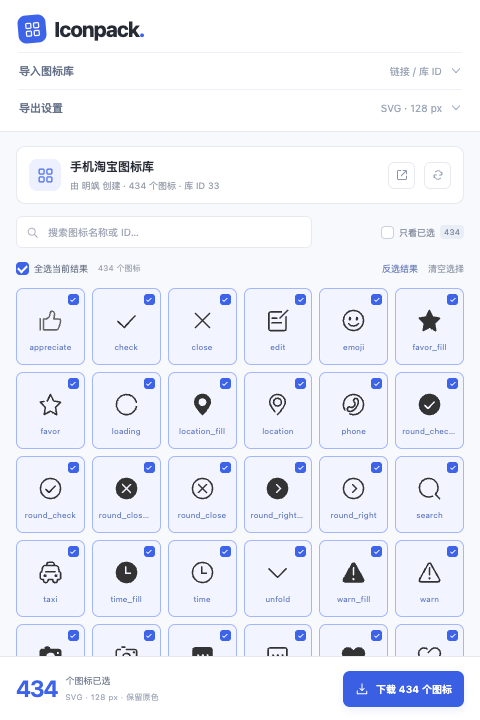
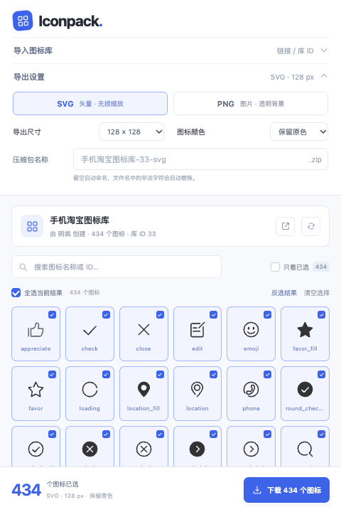
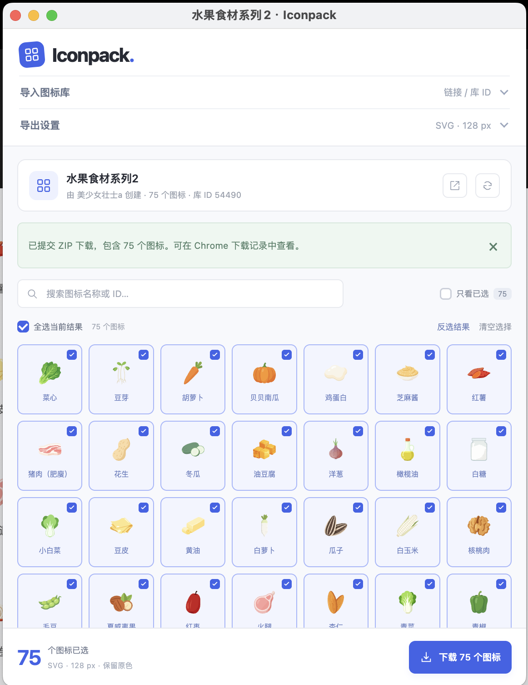

<p align="center"></p>

<h1 align="center">Iconpack · iconfont 批量下载</h1>

<p align="center">在一个小窗口里选图标、调参数，把整库打包带走。</p>
<p align="center">Chrome Manifest V3 · SVG / PNG · 本地 ZIP · MIT License</p>

Iconpack 是一个开源 Chrome 扩展，用于批量下载 **iconfont 任意可访问图标库**。自动识别当前库，也支持粘贴库链接或输入数字库 ID。无需安装 Node.js，无需运行服务，加载扩展即可使用。

## 界面预览

<p align="center"> </p>

<details>
<summary>查看实际使用示例：水果食材系列 2，75 个图标批量下载</summary>
<br>
<p align="center"></p>

该图为用户提供的实际操作截图。示例图标来自 [水果食材系列 2](https://www.iconfont.cn/collections/detail?cid=54490)，版权归原作者所有。
</details>

## 功能

| 功能 | 说明 |
| --- | --- |
| 通用图标库读取 | 自动识别当前图标库，或粘贴链接 / 输入库 ID |
| 批量选择 | 默认选中整库，支持搜索、全选当前结果、反选、清空与只看已选 |
| SVG / PNG | SVG 保持矢量；PNG 使用透明背景 |
| 图片规格 | 32、64、128、256、512、1024 px；原色或自定义单色 |
| ZIP 名称 | 自定义压缩包名称，或按图标库自动命名 |
| 导出反馈 | 显示处理进度，支持取消、失败项重试和来源记录 |
| 紧凑窗口 | 默认约占屏幕 1/3 宽、3/4 高；设置折叠，下载按钮固定在底部 |
| 本地处理 | 图标清理、PNG 转换和 ZIP 打包均在本机执行 |

## 安装与使用

### 1. 获取插件

推荐在本仓库的 **Releases** 页面下载 `iconpack-1.1.0.zip` 并解压。

也可以点击 **Code → Download ZIP** 下载整个项目，或克隆源码。源码中的 `extension/` 就是可直接加载的插件文件夹，不需要构建或安装依赖。

### 2. 加载到 Chrome

1. 在 Chrome 地址栏输入 `chrome://extensions/`。
2. 开启右上角的 **开发者模式**。
3. 点击 **加载已解压的扩展程序**。
4. 若下载的是插件安装包，选择解压后包含 `manifest.json` 的文件夹；若下载的是整个项目源码，选择其中的 **`extension/`**，不要选择项目根目录。
5. 点击 Chrome 工具栏的扩展菜单，将 **Iconpack** 固定到工具栏。

> 当前通过本地加载方式使用，尚未上架 Chrome Web Store。请勿直接把 ZIP 文件拖进浏览器当作已签名扩展安装。

### 3. 打开任意图标库

例如：[手机淘宝图标库](https://www.iconfont.cn/collections/detail?cid=33) 或 [水果食材系列 2](https://www.iconfont.cn/collections/detail?cid=54490)。

在图标库页面点击右下角 **批量下载**，或点击 Chrome 工具栏中的 Iconpack。安装前已经打开的 iconfont 页面需要先刷新一次。

插件会在独立小窗口读取整库。若从其他页面打开，展开 **导入图标库**，粘贴链接或输入数字库 ID，再点击 **读取图标库**。

支持以下链接，附带 `spm` 等其他参数也可以：

```text
https://www.iconfont.cn/collections/detail?cid=33
https://www.iconfont.cn/plus/collections/detail?cid=33
```

### 4. 选择与下载

1. 默认选中全部图标；点击卡片可以取消或恢复选择。
2. 用名称或 ID 搜索，按需全选 / 反选当前结果。筛选不会自动清除其他图标的选择。
3. 展开 **导出设置**，选择 SVG 或 PNG、尺寸与颜色。
4. 可填写 **压缩包名称**，留空则自动命名；填写 `.zip` 后缀也不会重复追加。
5. 点击底部 **下载 N 个图标**，在 Chrome 下载记录中查看 ZIP。

导出时可以切换到其他窗口，但请保持下载器窗口打开。需要停止时点击取消。格式、尺寸和颜色偏好会自动保存在当前浏览器。

## 下载包内容

```text
图标库名称-库ID-svg.zip
├── icons/
│   ├── 图标名称-图标ID.svg
│   └── ...
├── manifest.json
└── README.txt
```

图标 ID 避免同名覆盖。`manifest.json` 记录原库链接、作者、导出参数、文件对应关系和失败详情。个别图标失败时，仍会导出其他图标，并提供 **选中失败项重试**；接口数量不足时会提示错误，避免把不完整内容当作整库导出。

## 常见问题

**找不到页面上的“批量下载”按钮？** 先刷新页面，并确认当前是带 `cid` 的图标库详情页。也可以直接从 Chrome 工具栏打开插件。

**显示网络错误、验证页面或无访问权限？** 先在 iconfont 官网完成登录 / 验证，再重新读取。插件使用现有会话，不绕过访问权限。

**如何更新本地插件？** 用新版文件替换原来的扩展目录，在 `chrome://extensions/` 点击 Iconpack 卡片的刷新按钮，再重新打开下载器。站点按钮更新后也需要刷新 iconfont 页面。

**窗口太小或太大？** 默认按当前屏幕可用区域的约 1/3 宽、3/4 高打开，小屏幕会调整到可用范围；打开后可拖动窗口边缘自由缩放。

**支持个人项目、插画或字体文件吗？** 当前面向图标库详情页，暂不包含个人项目、插画、3D 素材与字体生成。网站接口变化时可能需要更新插件。

## 隐私与权限

扩展仅访问 `https://www.iconfont.cn/`。没有广告、遥测、远程执行代码或图标上传服务。完整说明见 [隐私政策](PRIVACY.md)。

| 权限 | 用途 |
| --- | --- |
| `activeTab` | 用户点击工具栏时读取当前图标库 URL |
| `storage` | 在本地保存格式、尺寸和颜色偏好 |
| `https://www.iconfont.cn/*` | 获取图标库接口数据，显示站点启动按钮 |

图标 SVG 经过元素与属性白名单清理，不执行其脚本或加载外部资源。文件下载使用本地 Blob，不需要 `downloads`、`cookies` 或所有网站访问权限。

## 开发与验证

运行扩展无需开发环境。执行开发检查需要 **Node.js 18+、Python 3**，没有生产依赖：

```sh
npm test          # URL、数据完整性、文件名、CRC-32 与独立 ZIP 解包验证
npm run check    # JavaScript 语法与 manifest 资源检查
npm run package  # 生成 dist/iconpack-1.1.0.zip
```

修改 `extension/` 后，在 Chrome 扩展管理页刷新插件。GitHub Actions 会运行基础检查并生成安装包构建产物。

可选浏览器测试需要 Playwright、Chromium 及用于像素检查的 Pillow：

```sh
npm install --no-save --package-lock=false playwright
npx playwright install chromium
python3 -m pip install pillow
npm run test:browser
npm run test:extension
```

`test:browser` 使用本地模拟接口验证选择、SVG 清理、PNG 透明背景与颜色、异常反馈、取消、文件名和紧凑布局；`test:extension` 在一次性浏览器配置中实际加载扩展，联网验证整库下载、设置保存、页面按钮与窗口比例，不使用个人 Chrome 配置。

支持环境变量：`ICONFONT_FIXTURE`（真实接口 JSON 路径，用于增加整库测试）、`PLAYWRIGHT_MODULE`、`CHROME_PATH`、`PIL_PYTHON`（指定相应测试运行时）。测试产物位于 `test-results/`，不会提交到仓库。

已验证：9 项基础测试，434 个真实 SVG 整库导出，真实扩展中的 434 个 PNG 导出，以及 360×540 / 480×720 窗口布局。

```text
extension/            可直接加载的 Chrome 扩展
  manifest.json       Manifest V3 配置
  background.js       工具栏、站点按钮与独立窗口启动
  content.js          iconfont 页面启动按钮
  workspace.*         下载器界面与交互
  compact.css         小窗口布局
  lib/                图标数据、SVG / PNG 与 ZIP 处理
  icons/              扩展图标
scripts/              检查、打包与素材工具
tests/                单元与浏览器测试
docs/                 README 操作截图
.github/workflows/    自动检查与安装包构建
```

ZIP 使用标准 STORE 格式，兼顾兼容性与本地处理速度。贡献方式见 [CONTRIBUTING.md](CONTRIBUTING.md)，更新记录见 [CHANGELOG.md](CHANGELOG.md)。

## 许可证与素材授权

扩展源码使用 [MIT License](LICENSE)。图标版权归原作者，使用前请确认原库授权；本项目的 MIT 许可证不覆盖下载的图标或截图中的第三方素材，详见 [第三方内容说明](THIRD_PARTY_NOTICES.md)。

Iconpack 是独立开源工具，与 iconfont、阿里巴巴或 Google 没有隶属或背书关系。
